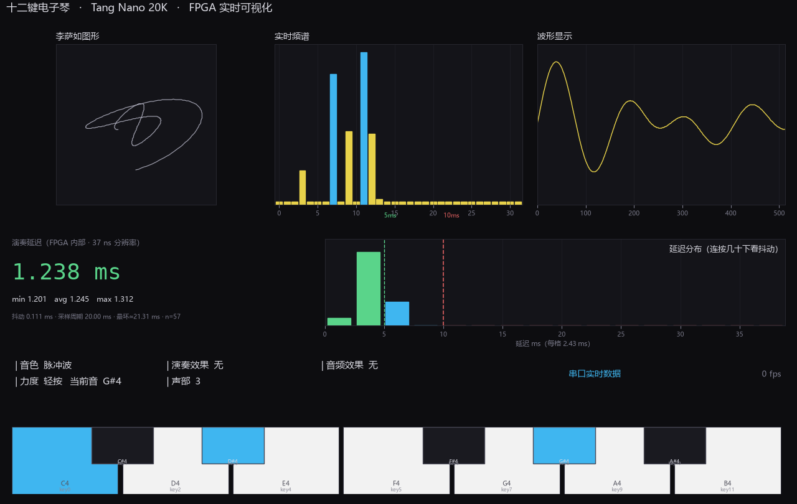

# FPGA 电子琴 · PC 上位机（可视化 + 延迟测量）

> ⚠️ **本目录是 v1 时代的上位机（Python + LabVIEW 对接），已停止维护。**
> 现行上位机在 [`host_ui/`](../host_ui)：Electron 版（直接读 CH340，内嵌 HTTP 8099）
> 或浏览器版（配 `bridge_server.py`）。
> 保留本目录只为存档：`synth_viz.py` 的协议解析与 LabVIEW 文档仍有参考价值。

> 配合 Tang Nano 20K 上的 `synth_ttp229` 固件使用。
> 界面：**李萨如图形 / 实时频谱 / 波形显示 / 演奏延迟** 四个面板 + 状态栏 + 钢琴键盘。



---

## 1. 运行环境

| 项 | 要求 |
|---|---|
| Python | **3.10 以上**（开发环境 3.12 x64） |
| 依赖 | `numpy`、`matplotlib`（**不需要 pyserial**，串口用 ctypes 调 Win32 API） |
| 系统 | Windows（依赖 Win32 串口 API） |
| 显示 | 支持 150%/200% 缩放（已做 DPI 感知） |

安装依赖：

```powershell
D:\Tools\Python\python.exe -m pip install numpy matplotlib
```

---

## 2. 快速运行

```powershell
# ① 演示模式（不接板子，点键盘就能看三个图动起来）
python synth_viz.py

# ② 串口模式（自动连接）
python synth_viz.py --port COM9

# ③ 启动即最大化
python synth_viz.py --port COM9 --zoom

# ④ 导出当前画面为 PNG（做 PPT 用）
python synth_viz.py --selftest out.png
```

---

## 3. 硬件连接（串口模式）

FPGA 的串口信号引到了 4 个排针上，**任选一个**接 USB-TTL：

```
USB-TTL 模块            Tang Nano 20K
─────────────          ──────────────
GND        ──────────  GND                    ← 必接
RXD        ──────────  69 / 42 / 48 / 77 / 79  ← 任选一个
TXD        ──────────  不接
VCC/3V3    ──────────  不接（板子自己 USB 供电）
```

- USB-TTL 的电平跳线拨到 **3V3**；
- 插上后设备管理器会出现 `USB-SERIAL CH340 (COMx)`；
- 界面上方输入框填那个 COM 号，点「连接」，标签从「演示模式」变成绿色的 `串口 COMx` 即成功。

帧率 15 fps、每帧 576 字节、115200 8N1。

---

## 4. 界面说明

| 面板 | 内容 |
|---|---|
| **李萨如图形** | x = 采样[i]，y = 采样[i+N/4] |
| **实时频谱** | 32 个对数频带（60 Hz ~ 16 kHz），亮蓝 = 该频带能量高 |
| **波形显示** | 512 个采样的时域波形 |
| **演奏延迟** | 大字读数 + `min/avg/max` + `抖动` + `采样周期` + `最坏≈` + 16 格直方图（绿 ≤5 ms / 蓝 5~10 / 红 >10，带 5 ms、10 ms 门限线） |
| **状态栏** | 音色 / 力度 / 当前音 / 声部数 / 音频效果 / fps |
| **钢琴键盘** | 可鼠标点击；串口模式下显示实体的按键状态 |

延迟大字配色：**≤5 ms 绿**、**5~10 ms 蓝**、**>10 ms 红**。

---

## 5. 三个工具脚本

放在 `tools\` 下，都是命令行运行：

| 脚本 | 用途 |
|---|---|
| `_probe_frames.py COM9 3` | 探测串口是否在发帧，打印前几帧的音色/按键/声部/延迟 |
| `_probe_audio.py COM9 30` | 连续监测 30 秒，报告**按键时与空闲时的音频采样峰值**（判断"没声音"是数字侧还是模拟侧） |
| `_calibrate_raw.py COM9 120` | 记录每次按键的键位与时间，用于标定实体键盘的通道映射 |
| `_watch_keys.py COM9 45` | 记录出现过的所有键值组合（查极性/误触发） |
| `_test_latency_panel.py` | 离线自测：构造一帧假数据，验证解析与延迟面板渲染 |

`analyze_noise.py` 在根目录，用于**噪声频谱对比**（电源改造前后）：

```powershell
python analyze_noise.py step0.wav step1.wav step2.wav
```

输出每个文件的频谱图、1k/2k/5k/10k 四个关注点的 dB、以及相对基线的差值，
并按「≥10 dB 明显有效 / 3~10 dB 部分有效 / <3 dB 无效」自动判定。

---

## 6. 文档（`docs\`）

| 文件 | 内容 |
|---|---|
| `README-上位机.md` | 界面各部分的详细说明 |
| `延迟测量与演示.md` | 延迟怎么测、怎么演示、答辩话术、常见问题 |
| `串口协议规格-给LabVIEW.md` | 576 字节帧的完整规格（LabVIEW 也照这个实现） |
| `LabVIEW搭建指南.md` | 用 LabVIEW 重做上位机的完整步骤 |
| `LabVIEW-用NET节点读串口.md` | 不装 NI-VISA 用 .NET 读串口的方法 |

`lv_bridge.py` 是给 LabVIEW 的 Python Node 用的后端，接口：
`read_frame()` / `spectrum()` / `lissajous_xy()` / `decode_frame()`。

---

## 7. 已知行为

| 现象 | 说明 |
|---|---|
| **本程序不发声** | 它只做可视化，声音永远从板子的喇叭出 |
| 演示模式下延迟面板显示「—— ms」 | 没有硬件数据，正常 |
| 空闲时波形是直线、李萨如空白 | 数字侧完全静音（采样=0），正常 |
| 窗口最大化后画面铺满 | 已修复（旧版会缩在左上角） |
| 串口打不开（Access denied） | 有另一个进程占着 COM 口，关掉它（常见是上一次没退干净的本程序） |

---

## 8. 文件清单

```
fpga_synth_host_viz/
├─ synth_viz.py                 主程序（GUI）
├─ lv_bridge.py                 LabVIEW Python Node 后端
├─ analyze_noise.py             噪声频谱对比工具
├─ requirements.txt
├─ README.md                    本文件
├─ tools/                       5 个诊断/自测脚本
├─ docs/                        5 篇文档
└─ screenshots/                 3 张界面截图
```

---

*2026-10-31 · 对应固件 UserCode `0x00002161`（帧格式 576 字节）*
